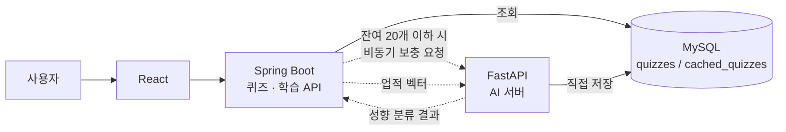

# AmaGetDon

> 투자 성향 기반 맞춤 금융 학습 · 모의투자 플랫폼

이 저장소는 팀 프로젝트 AmaGetDon에서 **제가 맡은 부분을 설명하는 문서**입니다.
팀 저장소는 비공개이며 팀이 후속 버전을 개발 중이어서, 코드 대신 설계와 의사결정을 정리했습니다.

---

## 개요

| 항목 | 내용 |
|---|---|
| 기간 | 2026.01.06 ~ 2026.02.09 (5주) |
| 형태 | SSAFY 14기 팀 프로젝트, 6인 (백엔드 2, 풀스택 4) |
| 내 역할 | 풀스택 — 퀴즈·학습 백엔드, FastAPI AI 서버, 학습 콘텐츠 데이터 |
| 기술 | Java 17, Spring Boot, MySQL, Redis, Python, FastAPI, XGBoost, React, TypeScript, Docker, AWS EC2 |

서비스는 사용자의 투자 성향에 맞춰 학습 커리큘럼을 구성하고, 챕터 학습과 퀴즈, 모의투자를 제공합니다. 학습·투자 활동으로 얻은 업적을 바탕으로 투자 성향을 다시 분류합니다.

---

## 내가 담당한 것

1. [무한 퀴즈 구조: 사전 제작 퀴즈 + 선제 생성 풀](#1-무한-퀴즈-구조-사전-제작-퀴즈--선제-생성-풀)
2. [학습 콘텐츠: 26챕터와 퀴즈 815개 생성 · 검수](#2-학습-콘텐츠-26챕터와-퀴즈-815개-생성--검수)
3. [업적 기반 투자 성향 재분류 (XGBoost)](#3-업적-기반-투자-성향-재분류-xgboost)

### 전체 구조



Spring Boot는 비즈니스 로직과 조회, FastAPI는 퀴즈 보충과 성향 분류를 맡도록 서버 역할을 나눴습니다. AI 처리가 느려져도 메인 API가 영향을 받지 않게 하고, Python ML 생태계를 그대로 쓰기 위해서입니다.

---

### 1. 무한 퀴즈 구조: 사전 제작 퀴즈 + 선제 생성 풀

**요구사항**: 사용자가 하루에 퀴즈를 제한 없이 풀 수 있어야 한다.

**제약**: AI 호출은 비용이 들고, 프로젝트에서 제공되는 토큰은 한정되어 있다.

**설계**

```
오늘 푼 퀴즈 수 확인
 ├─ 1 ~ 100번   : 사전 제작한 quizzes 테이블에서 조회 (이미 푼 문제 제외)
 ├─ 101번 이후  : cached_quizzes 테이블에서 미사용 퀴즈 조회 (한 번 쓴 퀴즈는 재사용하지 않음)
 └─ 미사용 cached_quizzes 20개 이하 : FastAPI에 비동기 보충 요청
```

| 결정 | 이유 |
|---|---|
| 하루 100문제까지는 사전 제작 퀴즈 사용 | AI 호출 비용을 관리하는 1차 정책. 대부분의 사용 구간을 비용 없이 처리 |
| `quizzes`와 `cached_quizzes` 테이블 분리 | 사전 제작 퀴즈는 학습 이력·오답노트와 FK로 연결된 영속 데이터이고, 생성 퀴즈는 한 번 쓰면 끝나는 소비형 데이터. 수명이 다른 데이터를 한 테이블에 두면 제약과 인덱스가 충돌 |
| 잔여 20개 이하에서 미리 보충 | 0개가 된 뒤 생성하면 그 순간 요청한 사용자는 퀴즈를 받지 못함. 소진보다 보충이 앞서도록 버퍼를 둠 |
| `@Async` + 전용 `ThreadPoolTaskExecutor` | 동기 호출 시 퀴즈 조회 응답이 AI 생성 시간에 묶임. 별도 스레드로 분리하고 메인 요청은 즉시 응답 |
| FastAPI가 DB에 직접 저장, Spring Boot는 조회만 | 비동기 경계에서 트랜잭션 전파 문제가 생기지 않도록 생성과 조회의 책임을 분리 |
| 호출당 평균 토큰으로 생성 가능 규모 산정 | 제공 토큰으로 약 33,000개를 생성할 수 있는 규모임을 설계 단계에서 확인 |

**한계**

- 운영 중 보충되는 퀴즈는 코드의 검증 함수로 정답 존재와 정답 1개 여부만 확인합니다. 금융 내용의 정확성은 검증하지 못했습니다.

**그 외**: 오답노트는 같은 퀴즈가 중복 저장되지 않도록 존재 여부를 먼저 확인하고, 중복이면 명확한 응답을 돌려주도록 구현했습니다.

---

### 2. 학습 콘텐츠: 26챕터와 퀴즈 815개 생성 · 검수

학습 콘텐츠 26챕터와 퀴즈 815개(OX 426개, 객관식 389개)를 생성형 AI로 혼자 만들고 검수했습니다.

| 단계 | 내용 |
|---|---|
| 기준 설정 | 챕터별 학습 목표를 먼저 정해, 어떤 개념을 어떤 난이도로 다룰지 구조화 |
| 템플릿 | 퀴즈 유형(OX, 객관식)별 템플릿을 직접 작성해 출력 형식과 품질을 통일 |
| 검수 | 금융 지식의 정확성, 난이도 편향, 중복 문항, 오답 선택지의 교육적 가치(왜 틀렸는지 스스로 알 수 있는지)를 기준으로 전수 검토 |
| 일정 관리 | 토큰 한도에 걸리지 않도록 AI 계정 2개를 번갈아 쓰고, 프로젝트 초반부터 생성을 시작 |

AI가 만든 금융 내용은 사실관계가 틀리는 경우가 있어서, 생성보다 검수 기준을 세우는 데 더 많은 시간을 썼습니다.

---

### 3. 업적 기반 투자 성향 재분류 (XGBoost)

학습·투자 활동으로 얻은 업적 패턴으로 투자 성향(공격형 / 중립형 / 안정형)을 다시 분류하는 기능입니다.

| 결정 | 이유 |
|---|---|
| 업적 18개의 달성 여부를 18차원 이진 벡터로 표현 | 업적 수가 프로젝트 범위에서 고정되어 있어 단순한 입력 구조로 충분 |
| 업적 ID를 고정 인덱스에 매핑 | 학습 시점과 추론 시점의 특징 순서가 어긋나지 않도록 보장. 업적이 늘면 벡터를 재설계해야 하는 한계는 인지 |
| 성향별 행동 패턴을 가정한 시뮬레이션 데이터로 학습 | 출시 전이라 실사용자 데이터가 없었고, 비지도 군집은 결국 사람이 라벨을 붙여야 해서 지도 학습으로 결정 |
| 업적 5개 미만 사용자는 분석 대상에서 제외 | 대부분이 0인 벡터로는 의미 있는 분류가 어려워, 신뢰도 낮은 결과를 노출하지 않도록 함 |

**한계**

- 시뮬레이션 데이터로 학습했기 때문에 실사용자 환경에서의 분류 성능은 확인하지 못했습니다. 운영 데이터가 쌓이면 교체해 재학습해야 합니다.

---

## 협업

- 매일 아침 20분 스크럼(어제 한 일, 오늘 할 일, 이슈 공유)
- Jira로 이슈 관리, GitLab MR로 코드 리뷰
- 팀원들의 MR에 모두 참여해 확인하고 질문하며 도메인 간 진행 상황을 파악
- 일정이 밀린 팀원에게 업무 재분배를 먼저 제안해 함께 처리

---

## 회고

**배운 것**

- 대기 없는 서비스를 만들려면 소비 속도보다 보충이 앞서도록 버퍼를 설계해야 하고, 그 구조는 ERD에서 테이블을 나누는 결정에서 시작된다.
- 비동기 경계를 도입할 때는 생성과 조회처럼 각 레이어의 책임을 먼저 나눠야 트랜잭션 문제가 생기지 않는다.
- 행동 로그 기반 모델은 알고리즘보다 "무엇을 특징으로 정의할 것인가"가 품질을 좌우하고, 그 판단에는 도메인 지식이 필요하다.

**다음에 할 것**

- 생성 단계부터 구조화 출력을 적용해 AI 응답 파싱 실패를 없애기
- 생성 퀴즈의 내용 정확성을 검증하는 단계 추가
- 실사용자 데이터로 성향 분류 모델 재학습
